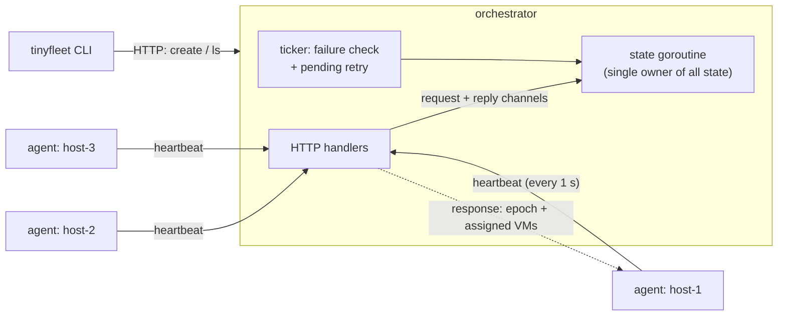
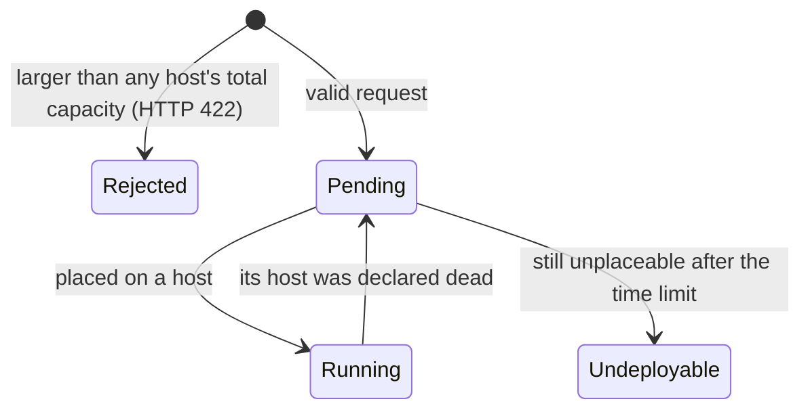

# tinyfleet

A toy **compute orchestrator** written in Go. It places virtual machines with *dedicated* CPU cores and memory onto a small fleet of hosts, notices when a host dies, and moves that host's VMs somewhere else.

It is a learning project. Nothing here runs a real VM. The goal is to reproduce, at a scale of three simulated machines, the core problems that real private-cloud compute platforms solve every day, and to make the design decisions behind them explicit.

> **Status:** design complete, implementation in progress. Sections marked *(planned)* describe intended behaviour that is not written yet.

---

## Contents

- [The problem](#the-problem)
- [What tinyfleet simulates](#what-tinyfleet-simulates)
- [Glossary](#glossary)
- [Architecture](#architecture)
- [How it behaves](#how-it-behaves)
- [Design decisions and trade-offs](#design-decisions-and-trade-offs)
- [What changes at real scale](#what-changes-at-real-scale)
- [The orchestrator itself: scaling and redundancy](#the-orchestrator-itself-scaling-and-redundancy-future-work)
- [Non-goals](#non-goals)
- [Building and running](#building-and-running-planned)
- [Project layout](#project-layout-planned)
- [References](#references)

---

## The problem

Companies that run their own data centres own thousands of physical servers ("bare metal"). Teams don't want a whole server; they want, say, *a machine with 4 CPU cores and 8 GB of RAM*. A **compute platform** turns the pile of servers into a pool that hands out such machines as virtual machines (VMs).

Three things make this hard:

1. **Placement.** When a request for a VM arrives, which server should run it? The server must have enough *free* capacity, and some choices waste capacity (fragmentation) or hurt performance.
2. **Dedicated resources.** Latency-sensitive workloads (databases, trading-style or real-time services) get cores that are reserved for them alone. Dedicated cores can never be oversold, so the orchestrator must account for every single core exactly, even when many requests arrive at once.
3. **Failure.** Servers crash, lose power or drop off the network. The platform has to notice, decide which VMs are gone, and restart them elsewhere, without accidentally running the same VM twice.

The usual architecture has three parts:

| Part | Runs where | Job |
|---|---|---|
| **Orchestrator** | Central service | Holds the desired state of the fleet: which hosts exist, which VMs exist, which VM goes where. |
| **Agent** | One per physical host | Reports the host's capacity and health, and makes the host match what the orchestrator decided. |
| **CLI** | Operator's laptop or automated system | Lets a human or automation ask for VMs and inspect the fleet. |

tinyfleet builds exactly that shape, small enough to read in one sitting.

## What tinyfleet simulates

| Real world | In tinyfleet |
|---|---|
| A rack of physical servers | 3 (or more) `agent` processes on one laptop, each started with a made-up capacity, e.g. `--cpus 64 --mem 256G` |
| Booting a VM with KVM/libvirt | Adding an entry to the agent's in-memory list. No virtualization happens. |
| A server crashing | Killing an agent process (`Ctrl-C` or `kill -9`) |
| A network partition | Pausing an agent (`kill -STOP`), so it is alive but silent |
| The control plane's database | In-memory state inside the orchestrator process |
| A user asking for a VM | `tinyfleet create --cpus 4 --mem 8G` |

What it **demonstrates**:

- Exact, race-free accounting of dedicated cores and memory under concurrent requests.
- Failure detection with heartbeats, and rescheduling of a dead host's VMs.
- Protection against "split brain", where a VM would run on two hosts at once.
- A pending queue for VMs that cannot be placed yet.
- Idiomatic Go concurrency: goroutines, channels, `select`, `context` cancellation, graceful shutdown, and tests that pass under the race detector.

## Glossary

| Term | Meaning |
|---|---|
| **Host** | One (simulated) physical server, represented by one agent. |
| **Dedicated resources** | Cores and memory reserved for exactly one VM. Never shared, never overcommitted. |
| **Placement** | Choosing a host for a VM. |
| **First-fit** | Placement strategy: walk the hosts in a fixed order and take the first one with room. |
| **Fragmentation** | Free capacity scattered in pieces too small to be useful, e.g. 2 free cores on each of 10 hosts when someone needs 8. |
| **Heartbeat** | A small periodic "I'm alive" message from agent to orchestrator. |
| **Desired state** | What the orchestrator wants to be true ("host A runs VMs 1 and 4"). The agent's job is to make reality match it. |
| **Level-triggered** | Every message carries the *full* desired state, not just a change, so a lost message is corrected by the next one. |
| **Fencing** | Making sure a host that has been declared dead can no longer act on old decisions. |
| **Epoch** | A number the orchestrator gives a host when it registers. A host whose epoch is out of date is fenced. |
| **Lease** | A time-limited permission. The agent may keep its VMs only while its lease is fresh. |
| **NUMA** | Non-Uniform Memory Access. Big servers have several CPU sockets, each with "near" memory. A VM whose cores and memory sit on different sockets runs slower. |

## Architecture



- **Agents pull.** The orchestrator never opens a connection to an agent. Each agent sends a heartbeat every second, and the response contains the complete list of VMs that host should run.
- **One goroutine owns the orchestrator's state.** HTTP handlers do not touch shared data. They send a request on a channel and wait for the reply. The periodic failure check is just another message to the same goroutine. No locks are needed.
- **Placement is a pure function**: `place(hosts, request) → hostID or "no fit"`. No I/O, no clock, no locks, so it can be tested on its own and swapped for a smarter strategy later.

### HTTP API *(planned)*

| Method and path | Who calls it | Purpose |
|---|---|---|
| `POST /hosts` | agent | Register with capacity; receive a host ID and epoch. |
| `POST /hosts/{id}/heartbeat` | agent | Report alive; receive the current epoch and the full list of assigned VMs. |
| `GET /hosts` | CLI | List hosts with capacity, usage and status. |
| `POST /vms` | CLI | Request a VM: `{"cpus": 4, "mem": "8G"}`. |
| `GET /vms` | CLI | List VMs with status and host. |

## How it behaves

### VM lifecycle



### Happy path

1. Three agents start and register. Each gets an ID and an epoch.
2. `tinyfleet create --cpus 4 --mem 8G` sends `POST /vms`.
3. The orchestrator runs first-fit over hosts in a fixed order, reserves 4 cores and 8 GB on the chosen host, and marks the VM `running`.
4. On its next heartbeat (≤ 1 s later), that host's agent sees the new VM in the response and adds it to its local list.

### A host dies

1. `host-2` stops sending heartbeats.
2. Its lease expires after **3 s** without a successful heartbeat. A real agent would stop its VMs at this point (the toy only logs it).
3. After **5 s** without a heartbeat, the orchestrator declares `host-2` dead and invalidates its epoch.
4. Its VMs go back into the pending queue. The next tick tries to place them on the remaining hosts. Any that do not fit stay `pending`.

Step 2 happens before step 3 on purpose; see [decision 2](#2-a-host-that-comes-back-epoch--agent-lease).

### A host comes back

1. `host-2` resumes (e.g. after `kill -CONT`) and sends a heartbeat with its old epoch.
2. The orchestrator sees a stale epoch and replies "re-register".
3. The agent drops every VM it still thinks it owns, registers again, and receives a new epoch and an empty assignment.

The VMs it used to run are already running elsewhere, so nothing runs twice.

## Design decisions and trade-offs

Each decision lists the alternatives that were considered and why this one won *for a toy*. What would change in production is covered in [What changes at real scale](#what-changes-at-real-scale).

### 1. How an agent learns its VMs: pull

**Chosen:** the heartbeat response carries the full list of assigned VMs.

- ✅ **Level-triggered.** A lost response is repaired by the next one, with no retry logic anywhere.
- ✅ **One connection direction.** The orchestrator doesn't need agent addresses, and agents can sit behind NAT.
- ✅ **Least code.** One HTTP client, in the agent.
- ❌ Up to one heartbeat interval (1 s) before an agent learns about a new VM.
- ❌ The response grows with the number of VMs per host.
- ❌ Liveness and state share one channel. If building the response became slow, heartbeats would look late. Mitigation: the heartbeat handler stays cheap.

**Rejected:** *push* (orchestrator calls agents). It's edge-triggered, so a failed push leaves the host out of sync, and you end up writing a reconciliation loop anyway. *Hybrid* (heartbeat for liveness, separate watch stream for state) is the right design at scale and too much for a toy.

### 2. A host that comes back: epoch + agent lease

Two mechanisms cover two different situations:

| Situation | Mechanism |
|---|---|
| Host is **partitioned but alive**: it can't hear the orchestrator, so the orchestrator can't tell it anything. | **Lease.** The agent fences *itself*: if it hasn't had a successful heartbeat for 3 s, it stops its VMs. |
| Host **comes back** after being declared dead. | **Epoch.** Its stale epoch is rejected, and it must drop its VMs and re-register. |

**Timing rule:** lease (3 s) < death timeout (5 s). The agent must give up its VMs *before* the orchestrator hands them to someone else. The 2 s gap absorbs network delay and clock rate drift.

Details:

- The lease is measured from when the agent **sent** its last acknowledged heartbeat, not when the reply arrived. The orchestrator may have recorded it at any time after sending, so this is the conservative choice.
- Both sides measure *durations* on their own monotonic clocks (Go's `time.Since` uses the monotonic clock), so wall-clock differences between machines don't matter.
- A 1 s heartbeat with a 5 s timeout tolerates several lost heartbeats before a false "dead" verdict.

**Known gap, documented rather than solved:** if the agent *process* dies but the VMs keep running, nobody fences them. Real systems use a watchdog (VMs are killed if the agent stops petting it) or out-of-band power fencing through the server's management controller (BMC/IPMI, "STONITH"). In tinyfleet the VMs are imaginary and live inside the agent, so **agent death equals VM death**. This assumption is deliberate.

**Second known gap:** the lease also expires when the *orchestrator* is down, so a control-plane outage longer than 3 s makes every agent stop its VMs. See [The orchestrator itself](#the-orchestrator-itself-scaling-and-redundancy-future-work).

**Rejected:** *re-register as empty* with no epoch. It is simpler but gives no way to tell a stale agent from a fresh one.

### 3. VMs that can't be placed: a pending queue

- A request that is larger than **any** host's total capacity can never succeed. It is rejected immediately with HTTP `422` and never queued.
- Anything else that doesn't fit *right now* becomes `pending`.
- On every tick, the orchestrator walks the pending queue **once**. It takes the queue length at the start of the pass and processes exactly that many items, so requeued VMs aren't retried in the same pass.
- A VM that still doesn't fit goes to the **back** of the queue, so one large VM can't block smaller ones behind it (no head-of-line blocking).
- Repeated failures back off (retry after 1, 2, 4… ticks, up to a ceiling) and the reason of the last failure is recorded.
- A VM that stays pending longer than a **configurable time limit** becomes `undeployable`. The limit is time-based rather than a count of attempts, so a VM evicted by a short host outage isn't given up after three quick retries.

**Known limitation:** small VMs can keep taking freed capacity, so a large VM may starve until its time limit. Real fixes (reserving capacity for the oldest pending VM, or raising priority with age) are listed under [scale](#what-changes-at-real-scale).

**Rejected:** *strict FIFO* (head-of-line blocking), *retry only when asked* (VMs get stranded), *retry only on events like registration* (every capacity-changing code path needs a hook, and it's easy to miss one). Retrying on the periodic tick is level-triggered, consistent with decision 1.

### 4. Placement: first-fit over a deterministic order

**Chosen:** first-fit, walking hosts in sorted ID order.

- First-fit packs VMs onto the low-index hosts and leaves the tail empty, which keeps whole hosts free for large VMs later.
- Best-fit (the host that would have the least space left over) packs tighter but leaves more unusable slivers. Least-loaded (spread) does the opposite: lower density, fewer hot spots. Packing and spreading are opposite goals; a real scheduler picks a weighting between them.

**Why the order matters:** Go deliberately randomizes map iteration order, so first-fit over a `map` would place VMs differently on every run. Hosts are therefore kept in two structures:

- a `map[HostID]*Host` for lookup, and
- a sorted `[]HostID` for iteration, updated with `slices.BinarySearch` + `slices.Insert` on registration.

Dead hosts are never removed from the slice; they are skipped by status. The slice therefore only changes on registration, and a test checks the invariant (sorted, same keys as the map) after random sequences of operations. Because only the state goroutine mutates either structure, keeping them in sync is local code.

**Rejected:** sorting the map keys on every placement (simpler and correct, but repeated work on every call), and registration order (a recovered host would jump to the end).

**Next step (stretch goal): NUMA-aware placement.** On a multi-socket server, a VM fits *well* only if its cores and memory can come from a single NUMA node. A VM whose resources span two sockets runs slower even though the host had "enough" in total. The planned design follows the *filter, then score* pattern used by the Kubernetes scheduler:

1. **Filter** (hard constraints): total capacity; for strict real-time VMs, *must* fit inside one NUMA node.
2. **Score** (preferences): prefer single-NUMA fit for every VM, then packing, then lower interference on shared resources (memory bandwidth, L3 cache, NIC and interrupt load), then spreading critical VMs across failure domains.

This needs hosts to be modelled as a list of NUMA nodes, which is why it is deferred. Keeping placement a pure function means the strategy can be replaced without touching anything else.

### 5. Concurrency: one goroutine owns the state (actor model)

**Chosen:** a single goroutine holds all orchestrator state. HTTP handlers and the ticker talk to it through channels.

- ✅ No locks. Overcommitting cores is impossible because only one goroutine ever reserves them.
- ✅ The failure check and the pending retry are just another `case` in the actor's `select`, not a separate goroutine racing the handlers.
- ✅ Very little for `go test -race` to find.
- ❌ More plumbing than a mutex (request and reply types, a channel per request).
- ❌ Everything serializes through one goroutine, like a single big lock.

Rules that keep it correct:

- Handlers `select` on `ctx.Done()` both when sending the request and when waiting for the reply, so a client that disconnects doesn't leak a goroutine.
- Reply channels have a buffer of 1, so the actor never blocks on a requester that has gone away.
- The actor never does I/O. JSON encoding and network writes happen in the handler, on a copy of the data.

**Rejected:** `sync.Mutex` (equally valid and less code; kept as the fallback), `sync.RWMutex` (little gain here; Go blocks new readers once a writer waits), and taking the lock per VM during rescheduling (new requests could grab the capacity that evicted, already-running VMs need).

## What changes at real scale

A production compute platform with thousands of hosts would change:

| Area | tinyfleet | At scale |
|---|---|---|
| State | In memory, lost on restart | A replicated store (e.g. etcd), with the orchestrator rebuilt from it |
| Availability | One orchestrator; an outage stops the fleet | Several replicas with leader election, so workloads survive control-plane outages ([details](#the-orchestrator-itself-scaling-and-redundancy-future-work)) |
| Agent protocol | Full state in every heartbeat | Liveness heartbeat plus a watch stream of changes with resource versions |
| Fencing | Epoch + lease; agent death = VM death | Plus a hardware/systemd watchdog and BMC power fencing |
| Placement | First-fit | Filter-then-score: NUMA and topology awareness, anti-affinity across racks and power domains, interference scoring |
| Pending queue | Requeue at tail, back-off, time limit | Priorities, preemption, capacity reservation and aging to prevent starvation |
| Rescheduling | Everything at once | Rate-limited, so a rack failure doesn't cause a thundering herd |
| API | Plain HTTP | Authentication, idempotency keys on create, quotas |
| Observability | Logs | Metrics, traces, alerting |

## The orchestrator itself: scaling and redundancy *(future work)*

tinyfleet runs **one** orchestrator, and the actor design depends on it: a single goroutine is the only writer of all state. That's what makes accounting simple and overcommit impossible. It also makes the orchestrator a single point of failure and a single bottleneck. The toy doesn't fix this, but the consequences and the options are worth stating plainly.

### What happens today when the orchestrator stops

- **All state is lost.** It lives in memory, so a restarted orchestrator knows no hosts and no VMs.
- **A restart empties the fleet.** Agents heartbeat with their old epoch, the new process doesn't recognize them and replies "re-register", and the agents drop their VMs.
- **Even a short outage stops every VM.** While the orchestrator is unreachable, every agent's lease expires after 3 s and every agent fences itself. The lease can't tell "*I* am cut off" from "the *control plane* is down".

Real platforms aim for the opposite property, often called **static stability**: when the control plane is unavailable, running workloads keep running; you just can't change anything until it's back.

### Where the load actually comes from

Not from VM requests: those are rare. The load is heartbeats. 10,000 hosts at one heartbeat per second is 10,000 requests per second, each one a message to the single state goroutine. The first scaling steps are therefore cheap and don't need a second orchestrator:

- **Longer heartbeat intervals with jitter**, scaled to fleet size (Nomad does this).
- **Send the assignment only when it changed.** The agent sends the version it holds, and most responses are "unchanged".
- **Keep liveness out of the state goroutine.** Last-seen timestamps can live in a separate concurrent table; the actor only receives "host X expired" events.

### Options for more than one orchestrator

| Option | How it works | Gains | Costs |
|---|---|---|---|
| **Active-passive** (leader election + replicated store) | Several replicas, one elected leader does all writes. State is stored in etcd or a Raft log; followers take over on failure. | Survives orchestrator failure. Keeps the single-writer model. | Doesn't add write throughput. Needs leader fencing and careful failover (below). |
| **Sharding into cells** | The fleet is split into independent cells, each with its own orchestrator (Borg's model). A thin router picks a cell per request. | Scales almost linearly. A bad cell only affects its own hosts (smaller blast radius). | Free capacity is split across cells, so a large VM may fit nowhere even though the fleet has room in total. Cross-cell moves are hard. |
| **Shared state, optimistic concurrency** | Several schedulers read the whole state and commit placements with compare-and-swap; conflicts are retried (Google's Omega). | Parallel scheduling, no single bottleneck. | Under contention, conflicts and retries pile up. The "overcommit is impossible by construction" argument becomes "overcommit is prevented by the store's transactions". |
| **Read replicas** | Followers serve read-only queries such as `GET /vms`, possibly slightly stale. | Takes read load off the leader. | Stale reads; doesn't help writes or availability by itself. |

### The likely path, and the problems it brings

Active-passive first, cells later if one leader isn't enough. The actor design makes the first step small: **the actor runs only on the leader**. What gets harder:

1. **Fencing the old leader.** A leader that is paused (long GC, VM migration) may not know it lost leadership and keep writing. Every write to the store must be conditional on the leader's lease still being current (an etcd transaction comparing the lease revision). This is the same epoch idea used for agents, one level up.
2. **Failover must not look like a fleet-wide failure.** Heartbeat timestamps are too frequent to persist, so a new leader starts with no "last seen" data. If it applied the 5 s death timeout straight away, it would declare every host dead and reschedule everything. It must treat all hosts as alive for one full death timeout after taking over.
3. **Agents must find the leader.** Agents can talk to any replica; followers redirect (HTTP `307`) or proxy to the leader.
4. **Leases must outlast a failover.** Electing a new leader and rebuilding state takes seconds, so a 3 s agent lease would fence the whole fleet on every failover. Leases need to be longer than the worst failover time, and the death timeout longer still. The trade-off is slower failure detection in exchange for surviving control-plane blips. Alternatively, agents can renew their lease with any replica instead of only the leader.
5. **Rebuild from agents instead of wiping them.** After a restart, the orchestrator can ask agents what they run and reconcile it with the store, instead of telling them to start empty. To keep fencing working, the orchestrator needs its own *incarnation ID* next to the host epoch: "the orchestrator restarted" means *report your VMs*; "your epoch is stale" still means *drop your VMs*.

### Why the toy stays single-node

Replication means a Raft implementation or an etcd dependency, roughly doubling the code, while the problems the toy exists to show (exact accounting, fencing, the pending queue) stay the same. The single-owner design was chosen so that moving to active-passive later is mostly "run the actor only on the leader, and persist what it writes".

## Non-goals

- **Real virtualization.** No KVM, libvirt or cgroups. That needs Linux and cgo; tinyfleet is pure Go and runs anywhere.
- **Persistence, leader election, high availability, sharding.** Discussed above, not built.
- **NUMA-aware placement.** Designed above as the first stretch goal.
- **A web UI or multi-tenancy.**

## Building and running *(planned)*

Requires Go 1.22 or newer (for method-based routing in `net/http`). There are no third-party dependencies.

```sh
go build ./...

# terminal 1: the orchestrator
go run ./cmd/orchestrator --listen :8080

# terminals 2-4: three simulated hosts
go run ./cmd/agent --name host-1 --cpus 64 --mem 256G --orchestrator http://localhost:8080
go run ./cmd/agent --name host-2 --cpus 64 --mem 256G --orchestrator http://localhost:8080
go run ./cmd/agent --name host-3 --cpus 64 --mem 256G --orchestrator http://localhost:8080

# terminal 5: ask for VMs and watch them land
go run ./cmd/tinyfleet create --cpus 4 --mem 8G
go run ./cmd/tinyfleet ls
```

Things to try:

- `Ctrl-C` an agent. After about 5 s its VMs move to the other hosts.
- `kill -STOP` an agent, wait 10 s, then `kill -CONT` it. It is told to re-register and comes back empty.
- Request more cores than the fleet has free. The VM stays `pending` until you start another agent.

Tests, with the race detector:

```sh
go test -race ./...
```

To build Linux binaries from macOS: `GOOS=linux GOARCH=amd64 go build ./...`

## Project layout *(planned)*

```
cmd/orchestrator/      main: flags, HTTP server, graceful shutdown
cmd/agent/             main: flags, heartbeat loop
cmd/tinyfleet/         the CLI (create, ls)
internal/api/          request/response types shared by all three binaries
internal/orchestrator/ the state goroutine, placement, pending queue, handlers
internal/agent/        heartbeat, lease, local view of assigned VMs
```

Only the standard library is used: `net/http`, `encoding/json`, `context`, `time`, `os/signal`, `log/slog`, `flag`, `slices`, `sync`.

## References

- Gergely Orosz, *Inside Agoda's Private Cloud*, The Pragmatic Engineer: [part 1](https://blog.pragmaticengineer.com/inside-agodas-private-cloud/), [part 2](https://newsletter.pragmaticengineer.com/p/inside-agodas-private-cloud-part-2). A public description of an orchestrator + agent + CLI platform for VMs on bare metal.
- [Kubernetes scheduler: filtering and scoring](https://kubernetes.io/docs/concepts/scheduling-eviction/kube-scheduler/)
- [Nomad architecture](https://developer.hashicorp.com/nomad/docs/concepts/architecture): clients pull work from servers via heartbeats.
- Martin Kleppmann, [*How to do distributed locking*](https://martin.kleppmann.com/2016/02/08/how-to-do-distributed-locking.html): fencing tokens and why leases alone aren't enough.

## License

GPL-3.0. See [LICENSE](LICENSE).
